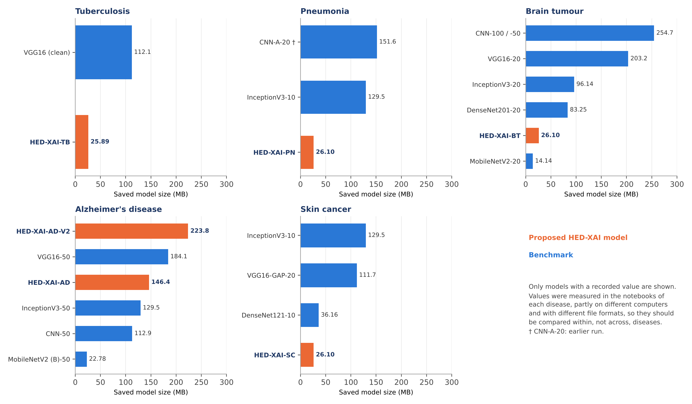
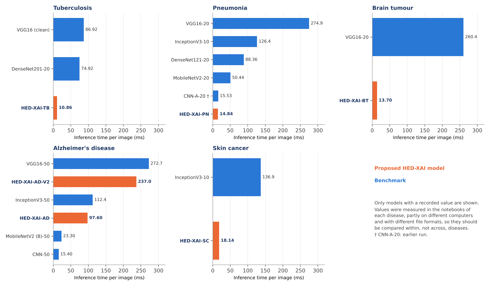

# HED-XAI — Explainable Hybrid Deep Learning for Multi-Disease Medical Image Classification

Code, executed notebooks and experimental records for the PhD dissertation

> **An Artificial Intelligence-Based Explainable Framework for Multi-Disease Medical Image Classification
> Using Deep Learning and Grad-CAM** — Hadi Almohab, 2026.

HED-XAI is defined by four shared design principles — (i) hybrid feature extraction across scales or
backbones, (ii) attention-based recalibration of the fused features, (iii) a compact regularised
classification head and (iv) a convolutional pathway that stays accessible to Grad-CAM — instantiated for
five diseases and three imaging modalities. Every disease folder contains the proposed hybrid model, the
benchmark models trained on the same split, the full test-set results and the Grad-CAM explanations.

| Disease | Modality | Folder | Proposed model | Test accuracy | Status |
|---|---|---|---|---|---|
| Alzheimer's disease (Non Demented vs. Very mild Dementia) | Brain MRI (OASIS-1) | [`alzheimer/`](alzheimer/) | HED-XAI-AD — VGG16 + InceptionV3 + channel attention | **92.83 %** (n = 600) | ✅ complete |
| Tuberculosis (Normal vs. TB) | Chest X-ray (TB Chest Radiography Database) | [`tuberculosis/`](tuberculosis/) | HED-XAI-TB — MobileNetV2 multi-scale fusion + channel attention | **99.50 %** (n = 1,001, de-duplicated; 100 % specificity) | ✅ complete |
| Pneumonia (Normal vs. Pneumonia) | Paediatric chest X-ray (Kermany) | [`pneumonia/`](pneumonia/) | HED-XAI-PN — MobileNetV2 multi-scale fusion + channel attention | **98.41 %** (n = 880; sensitivity 99.53 %) | ✅ complete |
| Brain tumour (glioma, meningioma, pituitary) | Brain MRI (Figshare) | [`brain_tumor/`](brain_tumor/) | HED-XAI-BT — MobileNetV2 multi-scale fusion + channel attention | **92.64 %** (n = 462; macro AUC 0.991) | ✅ complete |
| Skin cancer (benign vs. malignant) | Dermoscopy (Kaggle ISIC Malignant vs. Benign) | [`skin_cancer/`](skin_cancer/) | HED-XAI-SC — MobileNetV2 multi-scale fusion + channel attention | **87.88 %** (n = 660; ROC-AUC 0.9595) | ✅ complete |

## Cross-disease overview

<p align="center"><br></p>

The lightweight HED-XAI template (≈2.73 M parameters, ≈26 MB) is used unchanged for tuberculosis, pneumonia, brain tumour
and skin cancer; Alzheimer's disease uses a dual-backbone VGG16 + InceptionV3 instantiation. Values come from each
disease's notebooks and should be compared within, not across, diseases.

## Repository layout

```
HED-XAI/
├── README.md            # this file
├── requirements.txt     # Python dependencies (TensorFlow 2.17)
├── LICENSE              # MIT
├── CITATION.cff
├── alzheimer/           # one self-contained folder per disease
│   ├── README.md        # model, results, how to reproduce
│   ├── notebooks/       # original executed notebooks
│   ├── src/             # training, evaluation, Grad-CAM and analysis scripts
│   ├── results/         # metrics, training logs, classification reports, figures
│   └── data/README.md   # how to obtain the dataset
├── brain_tumor/         # same structure
├── pneumonia/           # same structure
├── skin_cancer/         # same structure
├── tuberculosis/        # same structure
└── overview/            # cross-disease figures (model size, inference time, dissertation structure)
```

## Quick start

```bash
git clone https://github.com/almohab/HED-XAI.git
cd HED-XAI
pip install -r requirements.txt
cd alzheimer            # or brain_tumor/, pneumonia/, skin_cancer/, tuberculosis/ — then follow that folder's README.md
```

## Data

No medical images are redistributed. Each disease folder explains where to download the public dataset and
how the split used in the dissertation is reproduced.

## Citation

If you use this code or these results, please cite the dissertation (see `CITATION.cff`).

## Disclaimer

This is research code. The models are **not** clinically validated and must not be used for diagnosis.
