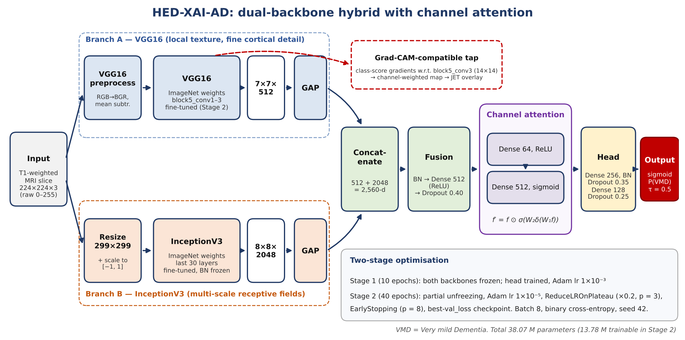
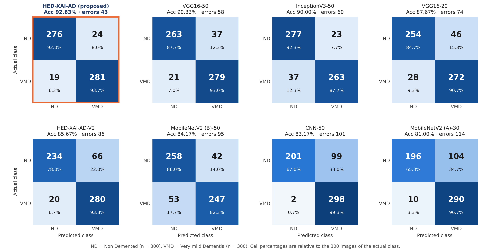
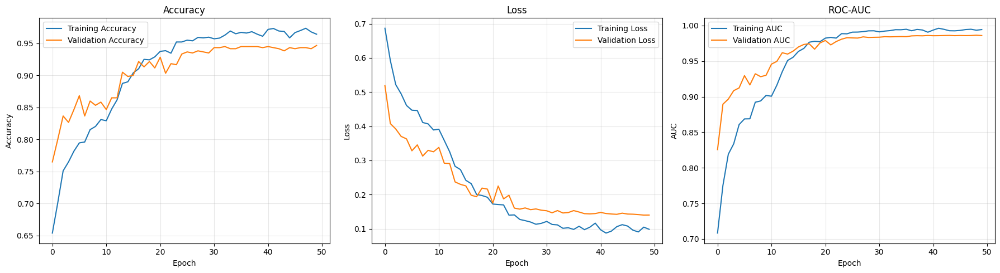
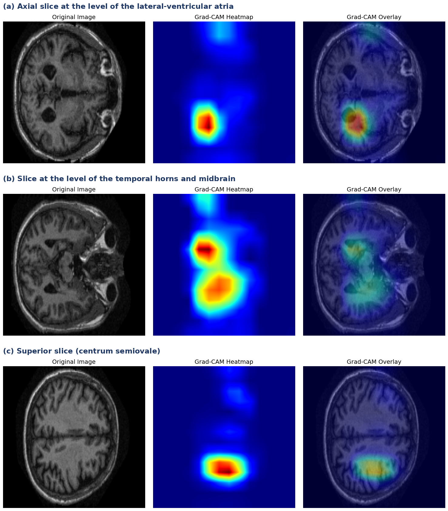

# HED-XAI-AD — Alzheimer's Disease (Non Demented vs. Very mild Dementia)

This folder contains the code, executed notebooks and complete training/evaluation records for the
**Alzheimer's disease** part of the PhD dissertation *"An Artificial Intelligence-Based Explainable Framework
for Multi-Disease Medical Image Classification Using Deep Learning and Grad-CAM"* (Chapter IV §4.2.4, §4.4.3;
Chapter V §5.4 and §5.6).

**Task:** binary classification of 2-D axial T1-weighted MRI slices from the OASIS-1 cohort —
*Non Demented* (CDR 0, label 0) vs. *Very mild Dementia* (CDR 0.5, label 1, positive class).



## Proposed model: HED-XAI-AD

| Component | Configuration |
|---|---|
| Branch A | VGG16 (ImageNet), 224×224, in-model VGG preprocessing → GAP (512-d) |
| Branch B | InceptionV3 (ImageNet), resized to 299×299, scaled to [−1, 1] → GAP (2,048-d) |
| Fusion | Concatenate (2,560-d) → BatchNorm → Dense 512 (ReLU) → Dropout 0.40 |
| Attention | Channel attention: Dense 64 (ReLU) → Dense 512 (sigmoid) ⊙ features |
| Head | Dense 256 → BatchNorm → Dropout 0.35 → Dense 128 → Dropout 0.25 → Sigmoid |
| Stage 1 | 10 epochs, both backbones frozen, Adam 1e-3 |
| Stage 2 | 40 epochs, VGG16 block5 + InceptionV3 last 30 layers (BatchNorm frozen), Adam 1e-5 |
| Callbacks | ModelCheckpoint (val_loss), ReduceLROnPlateau (×0.2, patience 3), EarlyStopping (patience 7/8) |
| Size | 38,070,433 parameters (13,779,521 trainable in Stage 2), 146.37 MB |

## Results (held-out test set, n = 600, 300 per class)

| Model | Epochs | Accuracy % [95% CI] | Sensitivity % | Specificity % | F1 | MCC | ROC-AUC | Errors |
|---|---|---|---|---|---|---|---|---|
| **HED-XAI-AD (proposed)** | 10+40 | **92.83** [90.49–94.64] | 93.67 | 92.00 | 0.9289 | 0.857 | 0.9843 | 43 |
| VGG16-50 | 50 | 90.33 [87.71–92.45] | 93.00 | 87.67 | 0.9058 | 0.808 | 0.97 | 58 |
| InceptionV3-50 | 50 | 90.00 [87.34–92.15] | 87.67 | 92.33 | 0.8976 | 0.801 | 0.97 | 60 |
| VGG16-20 | 20 | 87.67 [84.79–90.06] | 90.67 | 84.67 | 0.8803 | 0.755 | 0.95 | 74 |
| HED-XAI-AD-V2 (design iteration) | 20 | 85.67 [82.64–88.24] | 93.33 | 78.00 | 0.8669 | 0.722 | 0.9094 | 86 |
| VGG16-10 | 10 | 85.00 [81.92–87.63] | 96.00 | 74.00 | 0.8649 | 0.718 | 0.93 | 90 |
| MobileNetV2 (B)-50 | 50 (ES) | 84.17 [81.03–86.87] | 82.33 | 86.00 | 0.8387 | 0.684 | 0.93 | 95 |
| CNN-50 | 50 | 83.17 [79.96–85.95] | 99.33 | 67.00 | 0.8551 | 0.701 | 0.93 | 101 |
| MobileNetV2 (A)-30 | 20+10 | 81.00 [77.67–83.94] | 96.67 | 65.33 | 0.8357 | 0.653 | 0.90 | 114 |
| CNN-20 | 20 | 80.83 [77.49–83.78] | 85.33 | 76.33 | 0.8166 | 0.619 | 0.89 | 115 |

*95% CI = Wilson score interval. Benchmarks were evaluated with final-epoch weights, hybrids with their best
validation-loss checkpoint. Benchmark ROC-AUC values were read from the ROC plots (two decimals).
DenseNet121 was run on a different 8,000-image configuration (1,200 test images: 83.50 % accuracy, ROC-AUC 0.9196)
and is therefore not in the table. Full metrics: [`results/metrics_summary.csv`](results/metrics_summary.csv).*

<p align="center">
  <br>
  <br>
  
</p>

## Folder structure

```
alzheimer/
├── notebooks/                       # original executed notebooks (all outputs preserved)
│   ├── 01_baselines_CNN_VGG16_MobileNetV2_InceptionV3_DenseNet121.ipynb
│   ├── 02_HED-XAI-AD_hybrid_models_training_and_evaluation.ipynb
│   └── 03_GradCAM_VGG16_explanations.ipynb
├── src/
│   ├── prepare_balanced_dataset.py  # 2,000 + 2,000 balanced subset
│   ├── baselines/                   # CNN, VGG16, MobileNetV2, InceptionV3, DenseNet121
│   ├── hybrid/
│   │   ├── train_hed_xai_ad.py      # proposed model (two-stage training + evaluation)
│   │   ├── evaluate_hed_xai_ad.py   # evaluation only (no training)
│   │   └── train_hed_xai_ad_v2.py   # design iteration: VGG16 + DenseNet121 + CBAM
│   ├── explainability/gradcam_vgg16.py
│   └── analysis/                    # statistics and dissertation figures
├── results/
│   ├── metrics_summary.csv          # all models: confusion matrix, CI, sens/spec, F1, MCC, κ, AUC, size, speed
│   ├── metrics_all_models.json
│   ├── training_logs/               # per-epoch training/validation metrics (CSV)
│   ├── classification_reports/      # test-set reports exactly as printed by each run
│   └── figures/                     # training curves, confusion matrices, ROC/PR curves, Grad-CAM
└── data/README.md                   # how to obtain the dataset (images are not redistributed)
```

## How to reproduce

```bash
pip install -r requirements.txt            # from the repository root
# 1) download the Kaggle OASIS MRI dataset (see data/README.md) and build the balanced subset
AD_SOURCE_DIR=data/raw/Data python src/prepare_balanced_dataset.py
# 2) train and evaluate the proposed model
python src/hybrid/train_hed_xai_ad.py       # outputs -> outputs/HED-XAI-AD/
python src/hybrid/evaluate_hed_xai_ad.py
# 3) benchmarks (any of the scripts in src/baselines/)
python src/baselines/vgg16_50_epochs.py
# 4) Grad-CAM for the VGG16 benchmark
python src/explainability/gradcam_vgg16.py "data/balanced_data/Very mild Dementia/OAS1_0003_MR1_mpr-1_117.jpg"
# 5) statistics and dissertation figures (no GPU needed)
python src/analysis/statistics.py && python src/analysis/make_result_charts.py
```

All scripts read `AD_DATA_DIR` (default `data/balanced_data`) and `AD_OUTPUT_DIR`. Split: stratified
70/15/15 with `random_state=42` → 2,800 / 600 / 600 images. The hybrid experiments were run with
TensorFlow 2.17.0 (Keras 3) on CPU.

## Notes on the records

- The scripts in `src/` are the code of the executed notebook cells; only hard-coded Windows paths were
  replaced by environment variables, and `plt.show()` saves figures to disk. Two small fixes are marked in the
  code: a seed was added to the (originally unseeded) balanced sampling, and a crash in the test-evaluation block
  of `train_hed_xai_ad.py` was fixed — the reported HED-XAI-AD results come from `evaluate_hed_xai_ad.py`.
- `results/training_logs/` were reconstructed from the saved notebook output. Jupyter truncated part of the
  output of long runs, so a few epochs are missing from the HED-XAI-AD, HED-XAI-AD-V2 and DenseNet121 logs; the
  complete Keras `CSVLogger` files were written to each run's output folder.
- **Limitations** (discussed in the dissertation): the split is per image, not per participant, so slices from
  the same OASIS subject can occur in training and test sets and the accuracies are likely optimistic; the
  benchmarks used heterogeneous training protocols; Grad-CAM maps were produced from the VGG16 benchmark.
- Trained weights are not stored in Git (146–224 MB, above GitHub's 100 MB file limit). Attach them to a
  GitHub Release if you want to share them.
