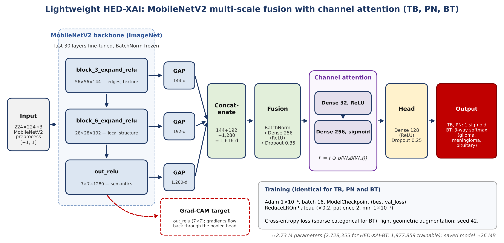
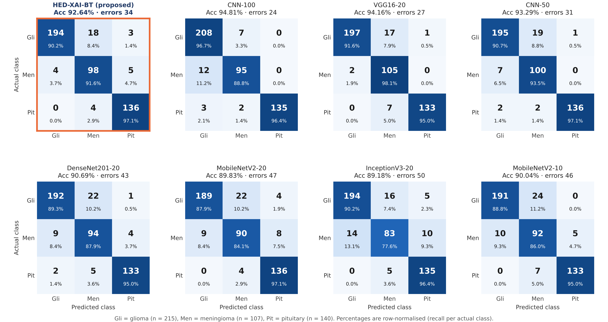
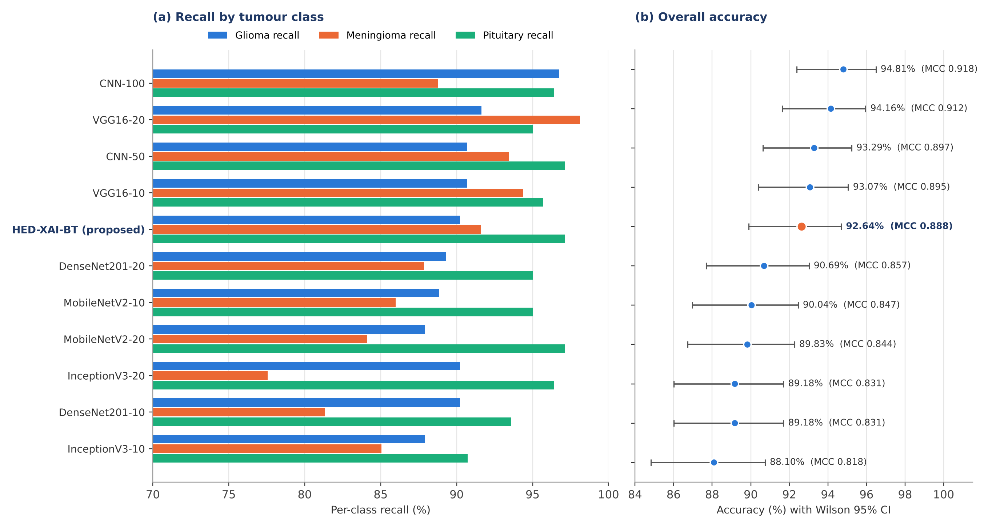
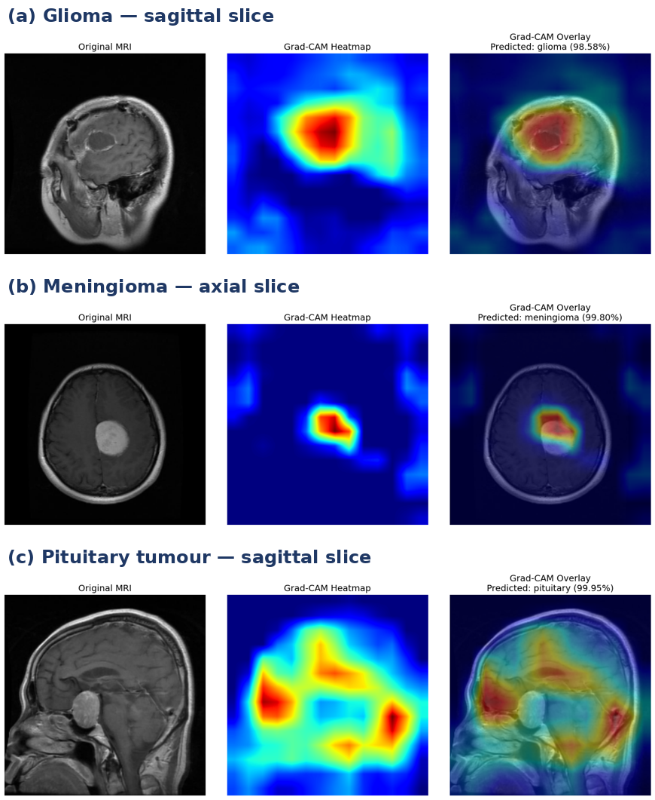

# HED-XAI-BT — Brain Tumour Classification (glioma, meningioma, pituitary)

Code, executed notebooks and complete training/evaluation records for the **brain tumour** part of the PhD
dissertation (Chapter IV §4.2.3, §4.4.2; Chapter V §5.3 and §5.6).

**Task:** three-class classification of contrast-enhanced T1-weighted MRI slices from the Figshare brain tumour
dataset (#1512427; 3,064 slices from 233 patients).



## Proposed model: HED-XAI-BT

| Component | Configuration |
|---|---|
| Backbone | MobileNetV2 (ImageNet), 224×224, MobileNetV2 `preprocess_input`; last 30 layers fine-tuned, BatchNorm frozen |
| Multi-scale taps | `block_3_expand_relu` (56×56×144), `block_6_expand_relu` (28×28×192), `out_relu` (7×7×1280) → GAP each |
| Fusion | Concatenate (1,616-d) → BatchNorm → Dense 256 (ReLU) → Dropout 0.35 |
| Attention | Channel attention: Dense 32 (ReLU) → Dense 256 (sigmoid) ⊙ features |
| Head | Dense 128 (ReLU) → Dropout 0.25 → Softmax (3 classes) |
| Training | Adam 1e-4, batch 16, 50 epochs, ModelCheckpoint (val_loss), ReduceLROnPlateau (×0.2, patience 2), seed 42 |
| Size | 2,728,355 parameters (1,977,859 trainable), 26.10 MB, 13.7 ms/image (batch), 32.7 min training (CPU) |

Best checkpoint: epoch 11 (val_loss 0.1551). A 100-epoch confirmation run selected the same checkpoint and
reproduced the test results exactly.

## Results (held-out test set, n = 462: 215 glioma, 107 meningioma, 140 pituitary)

| Model | Epochs | Accuracy % [95% CI] | Macro-F1 | MCC | Macro AUC | Recall G / M / P (%) | Errors | Size (MB) |
|---|---|---|---|---|---|---|---|---|
| CNN-100 | 100 | 94.81 [92.39–96.48] | 0.9440 | 0.918 | 0.99 | 96.7 / 88.8 / 96.4 | 24 | 254.66 |
| VGG16-20 | 20 (best @ 16) | 94.16 [91.63–95.95] | 0.9374 | 0.912 | 0.991 | 91.6 / 98.1 / 95.0 | 27 | 203.25 |
| CNN-50 | 50 | 93.29 [90.63–95.23] | 0.9300 | 0.897 | — | 90.7 / 93.5 / 97.1 | 31 | 254.66 |
| VGG16-10 | 10 | 93.07 [90.39–95.05] | 0.9257 | 0.895 | 0.99 | 90.7 / 94.4 / 95.7 | 32 | 203.25 |
| **HED-XAI-BT (proposed)** | 50 (best @ 11) | **92.64** [89.89–94.69] | 0.9202 | 0.888 | 0.991 | 90.2 / 91.6 / 97.1 | 34 | 26.1 |
| DenseNet201-20 | 20 | 90.69 [87.70–93.02] | 0.9000 | 0.857 | 0.98 | 89.3 / 87.9 / 95.0 | 43 | 83.25 |
| MobileNetV2-10 | 10 | 90.04 [86.97–92.45] | 0.8917 | 0.847 | 0.98 | 88.8 / 86.0 / 95.0 | 46 | 14.14 |
| MobileNetV2-20 | 20 | 89.83 [86.73–92.26] | 0.8890 | 0.844 | 0.98 | 87.9 / 84.1 / 97.1 | 47 | 14.14 |
| DenseNet201-10 | 10 | 89.18 [86.01–91.69] | 0.8825 | 0.831 | 0.98 | 90.2 / 81.3 / 93.6 | 50 | 83.25 |
| InceptionV3-20 | 20 | 89.18 [86.01–91.69] | 0.8783 | 0.831 | 0.97 | 90.2 / 77.6 / 96.4 | 50 | 96.14 |
| InceptionV3-10 | 10 | 88.10 [84.82–90.74] | 0.8698 | 0.818 | 0.97 | 87.9 / 85.0 / 90.7 | 55 | 96.14 |

*All metrics recomputed from the recorded confusion matrices; 95% CI = Wilson interval; MCC = multi-class
Matthews correlation. Macro AUC computed in the notebooks for HED-XAI-BT and VGG16-20, read from per-class ROC
plots (two decimals) for the others. None of the differences between the five leading models is statistically
significant (two-proportion z-test, p ≥ 0.18). Full table: [`results/metrics_summary.csv`](results/metrics_summary.csv).*

<p align="center">
  <br>
  <br>
  
</p>

## Folder structure

```
brain_tumor/
├── notebooks/            # 12 executed notebooks (outputs preserved)
│   ├── 01_data_conversion_split_and_MobileNetV2_10_epochs.ipynb
│   ├── 02–10 benchmark notebooks (CNN, VGG16, DenseNet201, MobileNetV2, InceptionV3)
│   ├── 11_HED-XAI-BT_hybrid_50_and_100_epochs.ipynb
│   └── 12_GradCAM_VGG16_explanations.ipynb
├── src/
│   ├── prepare_dataset.py           # .mat → JPEG conversion and 70/15/15 per-class split
│   ├── baselines/                   # 10 benchmark training scripts
│   ├── hybrid/train_hed_xai_bt.py   # proposed model (training + full evaluation)
│   ├── explainability/gradcam_vgg16.py
│   └── analysis/                    # statistics and dissertation figures
├── results/
│   ├── metrics_summary.csv          # all models: CI, macro metrics, MCC, κ, per-class recall/specificity, CM
│   ├── training_logs/               # per-epoch training/validation metrics (CSV)
│   ├── classification_reports/      # test results as printed by each run
│   └── figures/                     # training curves, confusion matrices, ROC/PR curves, Grad-CAM
└── data/README.md
```

## How to reproduce

```bash
pip install -r ../requirements.txt
# 1) download the Figshare .mat files (see data/README.md), then convert and split
BT_MAT_DIR=data/raw/BrainTumorDataset python src/prepare_dataset.py
#    rename the label folders 1/2/3 to meningioma/glioma/pituitary before the split step (see data/README.md)
# 2) proposed model
python src/hybrid/train_hed_xai_bt.py        # outputs -> outputs/HED-XAI-BT/
# 3) benchmarks, e.g.
python src/baselines/vgg16_20_epochs.py
# 4) Grad-CAM (VGG16-20 model)
python src/explainability/gradcam_vgg16.py
# 5) statistics and figures (no GPU needed)
python src/analysis/statistics.py && python src/analysis/make_result_charts.py
```

## Notes on the records

- `src/` contains the code of the executed notebook cells; only Windows paths were replaced by environment
  variables (`BT_DATA_DIR`, `BT_OUTPUT_DIR`, `BT_MAT_DIR`), and `plt.show()` saves figures to disk.
- The supplied notebooks contained two identical copies of the DenseNet201-20 run and of the CNN-50 run; one copy
  of each is kept. The VGG16-20 notebook contains an original run (94.37 %) and a re-run with checkpointing and full
  evaluation (94.16 %); the re-run is the reported model. A MobileNetV2 variant that also fine-tuned the last 100
  layers (notebook 01) reached 80.95 % and is not part of the comparison.
- **Limitations:** the split is per image, not per patient (the patient ID stored in each .mat file was not used),
  so slices of one patient can appear in training and test sets; benchmark protocols differ from the hybrid
  (no augmentation, frozen backbones, /255 input); Grad-CAM maps come from the VGG16-20 benchmark. The pituitary
  Grad-CAM example concentrates outside the sellar lesion — see the dissertation, §5.6.
- Trained weights are not stored in Git; attach them to a GitHub Release if you want to share them.
