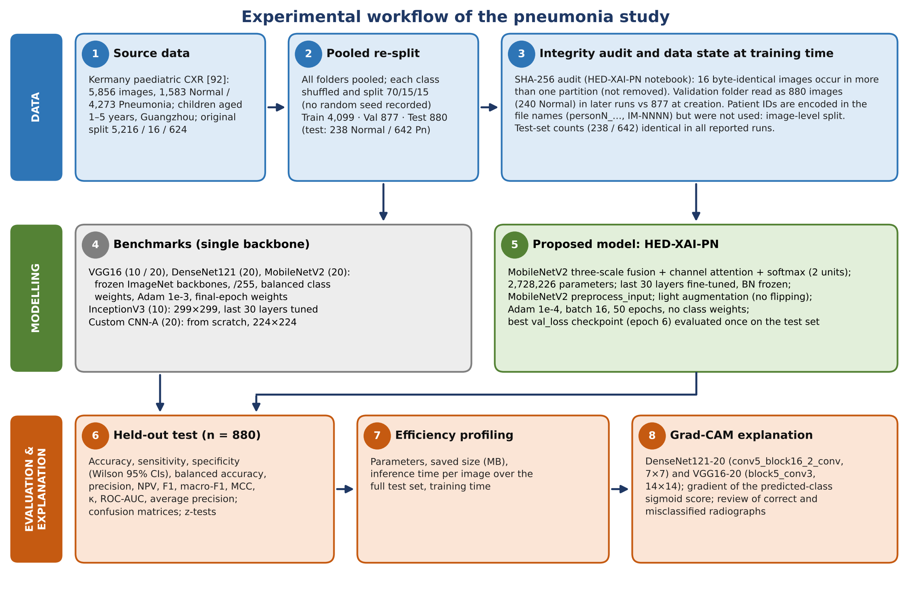
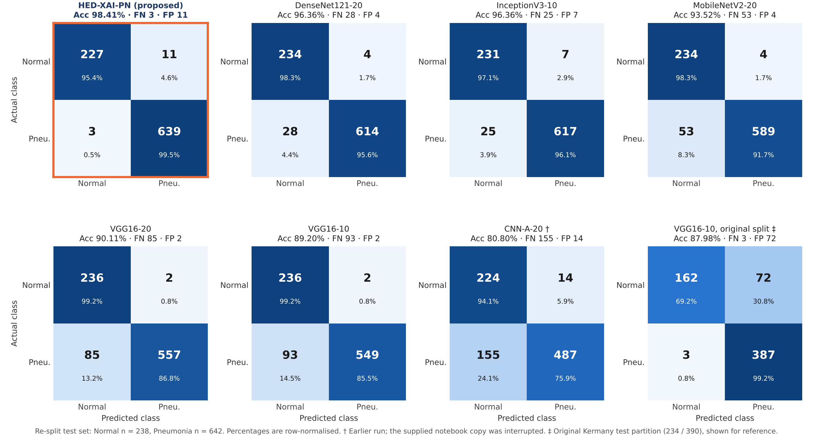
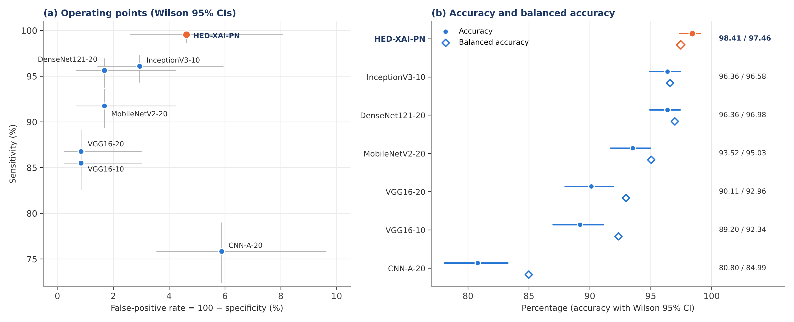
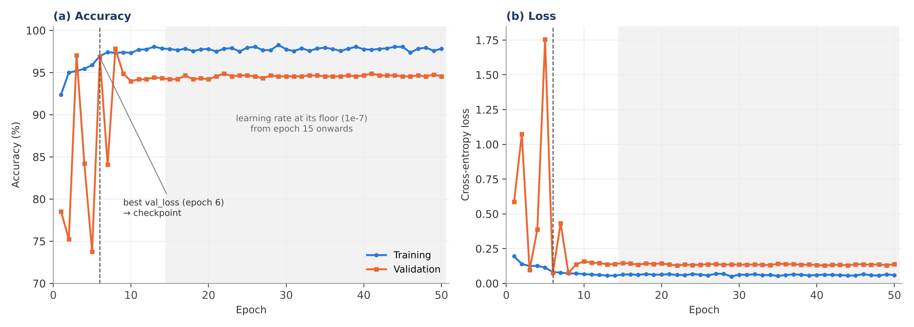
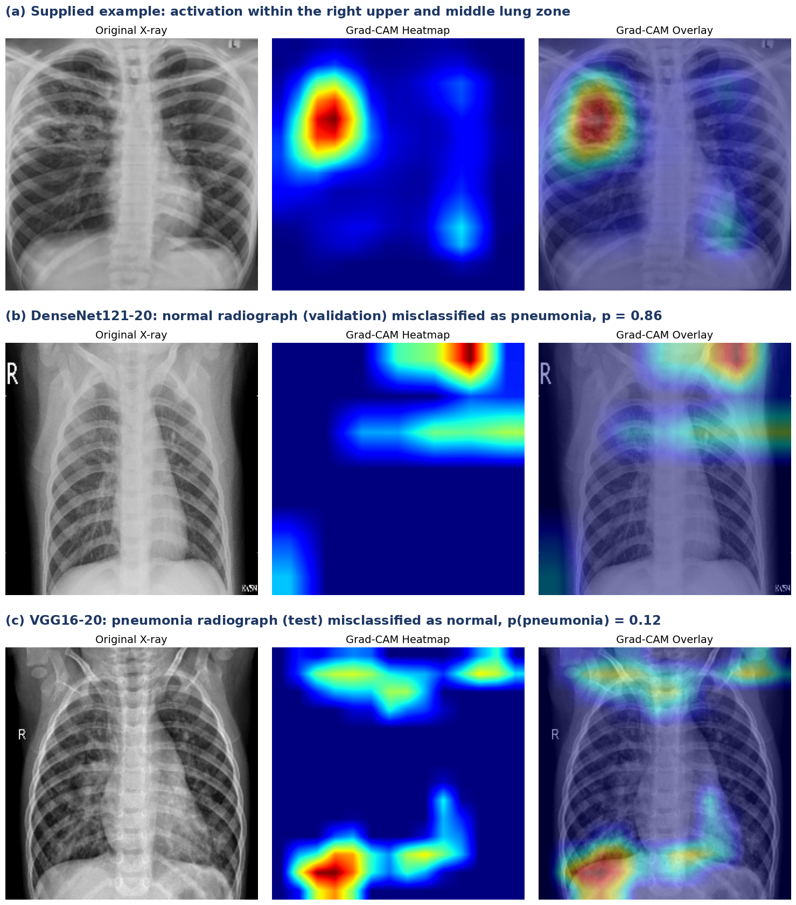

# HED-XAI-PN — Paediatric Pneumonia Detection from Chest X-rays (Normal vs. Pneumonia)

Code, executed notebooks and complete training/evaluation records for the **pneumonia** part of the PhD
dissertation (Chapter IV §4.2.2; Chapter V §5.2 and §5.6).

**Task:** binary classification of anterior–posterior chest radiographs of children aged 1–5 years from the Kermany
dataset (Guangzhou Women and Children's Medical Center; 5,856 images: 1,583 Normal, 4,273 Pneumonia).
Positive class = Pneumonia.



## Data split used in the dissertation

All original folders were pooled and each class was shuffled and split 70/15/15 → **4,099 / 877 / 880**
(test: 238 Normal / 642 Pneumonia). Points to know:

- the original shuffle had **no random seed**, so the split is reproducible only from the saved folders
  (`src/prepare_dataset.py` now sets `PN_SPLIT_SEED`, default 42, for future splits);
- when the folders were read for training, `val/` contained **880** images (240 Normal), three more than at creation;
- the SHA-256 audit in the hybrid notebook found **16 byte-identical images in more than one partition** (not removed);
- the split is **image-level**, although patient IDs are encoded in the file names — use
  `src/patient_level_tools.py overlap` to measure patient overlap and `… split` for a patient-level re-split.

## Proposed model: HED-XAI-PN

| Component | Configuration |
|---|---|
| Backbone | MobileNetV2 (ImageNet), 224×224, MobileNetV2 `preprocess_input`; last 30 layers fine-tuned, BatchNorm frozen |
| Multi-scale taps | `block_3_expand_relu`, `block_6_expand_relu`, `out_relu` → GAP each → concatenate (1,616-d) |
| Fusion / attention / head | BN → Dense 256 → Dropout 0.35 → channel attention (32 → 256, sigmoid) → Dense 128 → Dropout 0.25 → softmax (2) |
| Training | Adam 1e-4, batch 16, 50 epochs, sparse categorical cross-entropy, no class weights; augmentation rotation ±5°, shifts 3 %, zoom 5 %, no flipping; ModelCheckpoint (val_loss), ReduceLROnPlateau (×0.2, patience 2, min 1e-7), seed 42 |
| Size | 2,728,226 parameters (1,977,730 trainable), 26.10 MB, 14.84 ms/image, 86.96 min training (CPU) |

Best checkpoint: epoch 6 (val_loss 0.0761). The learning rate reached its floor (1e-7) at epoch 15, so epochs 15–50
changed the model very little; early stopping would cut training time to about a quarter.

## Results (held-out test set, n = 880: 238 Normal, 642 Pneumonia)

| Model | Epochs | Accuracy % [95% CI] | Sens % | Spec % | Bal. acc % | MCC | ROC-AUC | FN / FP | Params (M) | ms/img |
|---|---|---|---|---|---|---|---|---|---|---|
| **HED-XAI-PN (proposed)** | 50 (best @ 6) | **98.41 [97.35–99.05]** | 99.53 | 95.38 | 97.46 | 0.960 | 0.9991 | 3 / 11 | 2.73 | 14.84 |
| DenseNet121-20 | 20 | 96.36 [94.91–97.41] | 95.64 | 98.32 | 96.98 | 0.913 | 0.9966 | 28 / 4 | 7.30 | 88.36 |
| InceptionV3-10 | 10 | 96.36 [94.91–97.41] | 96.11 | 97.06 | 96.58 | 0.911 | 0.9949 | 25 / 7 | 22.36 | 126.40 |
| MobileNetV2-20 | 20 | 93.52 [91.70–94.97] | 91.74 | 98.32 | 95.03 | 0.853 | 0.9952 | 53 / 4 | 2.59 | 50.44 |
| VGG16-20 | 20 | 90.11 [87.96–91.91] | 86.76 | 99.16 | 92.96 | 0.793 | 0.9964 | 85 / 2 | 21.14 | 274.88 |
| VGG16-10 | 10 | 89.20 [86.98–91.09] | 85.51 | 99.16 | 92.34 | 0.777 | 0.9950 | 93 / 2 | 21.14 | 290.97 |
| CNN-A-20 † | 20 | 80.80 [78.06–83.26] | 75.86 | 94.12 | 84.99 | 0.628 | 0.9448 | 155 / 14 | 13.24 | 15.53 |
| VGG16-10, original Kermany split ‡ | 10 | 87.98 [85.19–90.30] | 99.23 | 69.23 | 84.23 | 0.752 | 0.9671 | 3 / 72 | 21.14 | — |

*Recomputed from the confusion matrices (Wilson 95% CI). HED-XAI-PN is significantly more accurate than every benchmark
(two-proportion z-test, p ≤ 0.007), but its gain is mostly sensitivity: specificity 95.38 % is the lowest among the
transfer-learning models and its balanced accuracy exceeds DenseNet121-20 by only 0.48 points. Benchmarks used frozen
backbones, /255 input, Adam 1e-3, balanced class weights and final-epoch weights (InceptionV3: last 30 layers tuned, no
class weights), so the comparison is not an ablation. † CNN-A-20: figures from an earlier run; the supplied notebook
copy was interrupted at epoch 15. ‡ Trained/evaluated on the original Kermany partition (test n = 624).
Full table: [`results/metrics_summary.csv`](results/metrics_summary.csv).*

<p align="center">
  <br>
  <br>
  <br>
  
</p>

## Folder structure

```
pneumonia/
├── notebooks/
│   ├── 01_benchmarks_resplit_VGG16_DenseNet121_MobileNetV2_CNN_InceptionV3_and_GradCAM.ipynb
│   ├── 02_HED-XAI-PN_hybrid_50_epochs.ipynb
│   └── 03_GradCAM_DenseNet121.ipynb
├── src/
│   ├── prepare_dataset.py              # pooled 70/15/15 re-split (seed added)
│   ├── patient_level_tools.py          # patient-overlap check and patient-level re-split (follow-up tool)
│   ├── hybrid/train_hed_xai_pn.py      # proposed model: training + full evaluation
│   ├── baselines/                      # 7 benchmark scripts (incl. VGG16 on the original partition)
│   ├── explainability/                 # Grad-CAM for VGG16-20 and DenseNet121-20
│   └── analysis/                       # statistics and dissertation figures
├── results/
│   ├── metrics_summary.csv / metrics_all_models.json
│   ├── training_logs/                  # per-epoch metrics (CSV)
│   ├── classification_reports/
│   └── figures/                        # notebook figures, Grad-CAM, dissertation figures
└── data/README.md
```

## How to reproduce

```bash
pip install -r ../requirements.txt
# 1) download the dataset (see data/README.md) to data/raw/chest_xray/{train,val,test}/{NORMAL,PNEUMONIA}
python src/prepare_dataset.py                  # -> data/chest_xray_new (seeded; not identical to the dissertation split)
python src/patient_level_tools.py overlap      # optional: patient overlap between partitions
# 2) proposed model
python src/hybrid/train_hed_xai_pn.py          # outputs -> outputs/HED-XAI-PN/
# 3) benchmarks, e.g.
python src/baselines/densenet121_20_epochs.py
# 4) Grad-CAM (needs the benchmark model from step 3)
python src/explainability/gradcam_densenet121.py
# 5) statistics and figures
python src/analysis/statistics.py && python src/analysis/make_result_charts.py
```

## Notes on the records

- `src/` contains the code of the executed notebook cells; only Windows paths were replaced by environment variables
  (`PN_RAW_DIR`, `PN_DATA_DIR`, `PN_OUTPUT_DIR`, `PN_MODEL`), and `plt.show()` saves figures to disk.
- Benchmarks and HED-XAI-PN were run on different computers; inference times are indicative.
- Grad-CAM maps come from benchmarks (DenseNet121-20 and VGG16-20), not from HED-XAI-PN. Both notebook examples are
  misclassifications (a normal validation image called pneumonia, a pneumonia test image called normal) with
  activation outside the lungs — see the dissertation, §5.6.
- Trained weights are not stored in Git; attach them to a GitHub Release if you want to share them.
