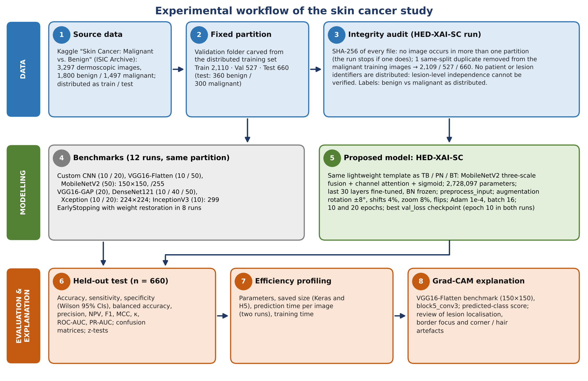
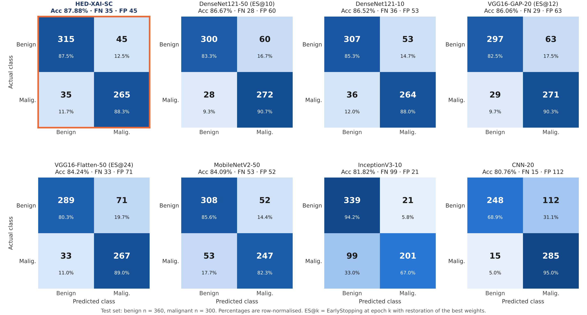
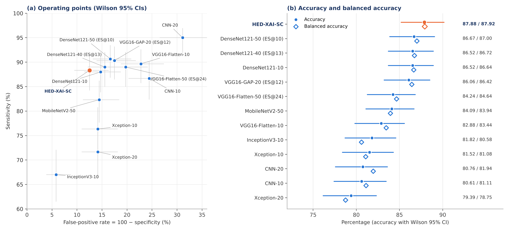
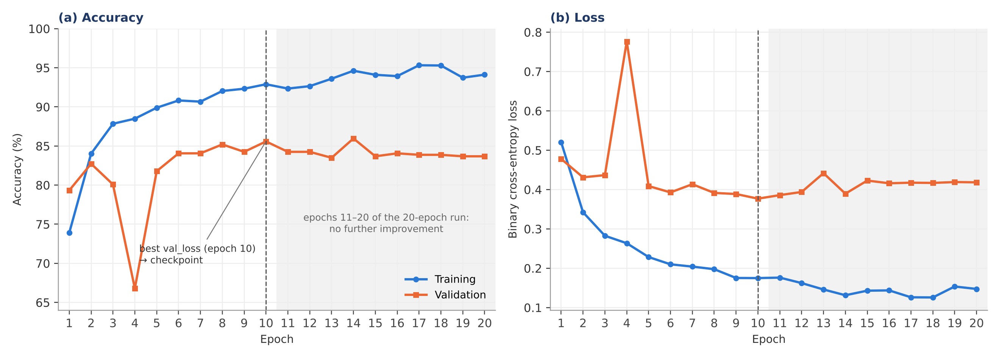
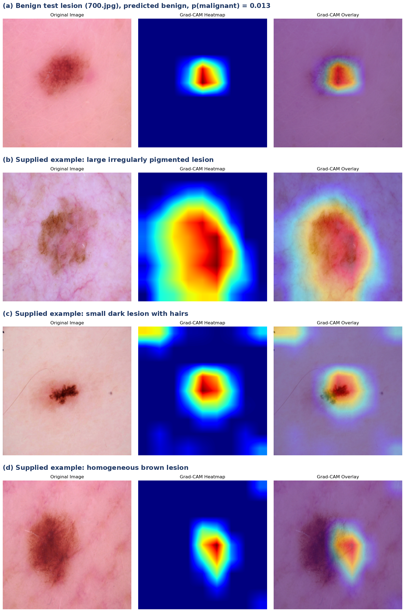

# HED-XAI-SC — Skin Cancer Classification from Dermoscopic Images (Benign vs. Malignant)

Code, executed notebooks and complete training/evaluation records for the **skin cancer** part of the PhD
dissertation (Chapter IV §4.2.5; Chapter V §5.5 and §5.6).

**Task:** binary classification of dermoscopic images from the Kaggle "Skin Cancer: Malignant vs. Benign" collection
derived from the ISIC Archive (3,297 images: 1,800 benign, 1,497 malignant). Positive class = Malignant.



## Data partition

Fixed folders `train/` (2,110: 1,152 benign / 958 malignant), `val/` (527: 288 / 239, separated from the distributed
training set) and `test/` (660: 360 / 300, the distributed test set). The SHA-256 audit in the hybrid notebook found
**no cross-partition duplicates** and removed one duplicate within the malignant training images (2,109 for HED-XAI-SC).
No patient or lesion identifiers are distributed, so lesion-level independence cannot be verified.

## Proposed model: HED-XAI-SC

The lightweight HED-XAI template, unchanged (identical to HED-XAI-TB): MobileNetV2 (ImageNet, 224×224,
`preprocess_input`, last 30 layers fine-tuned, BatchNorm frozen) tapped at `block_3_expand_relu`, `block_6_expand_relu` and
`out_relu` → GAP → concatenate (1,616-d) → BN → Dense 256 → Dropout 0.35 → channel attention (32 → 256) → Dense 128 →
Dropout 0.25 → sigmoid. Adam 1e-4, batch 16, augmentation rotation ±8°, shifts 4 %, zoom 8 %, horizontal flip;
ModelCheckpoint (val_loss), ReduceLROnPlateau (×0.2, patience 2). **2,728,097 parameters, 26.10 MB (.keras; 10.78 MB .h5),
18.14 ms/image, 14.95 min training (10 epochs).** The 10- and 20-epoch runs both selected epoch 10 (val_loss 0.3769) and
gave identical test results.

## Results (held-out test set, n = 660: 360 benign, 300 malignant)

| Model | Input | Epochs | Accuracy % [95% CI] | Sens % | Spec % | Bal. acc % | MCC | ROC-AUC | FN / FP | Params (M) |
|---|---|---|---|---|---|---|---|---|---|---|
| **HED-XAI-SC (proposed)** | 224 | 10 / 20 (best @ 10) | **87.88 [85.17–90.15]** | 88.33 | 87.50 | 87.92 | 0.757 | 0.9595 | 35 / 45 | 2.73 |
| DenseNet121-50 (ES@10) | 224 | 50 (stopped @ 10, best @ 4) | 86.67 [83.86–89.05] | 90.67 | 83.33 | 87.00 | 0.737 | 0.946 | 28 / 60 | 7.30 |
| DenseNet121-10 | 224 | 10 | 86.52 [83.70–88.91] | 88.00 | 85.28 | 86.64 | 0.730 | 0.952 | 36 / 53 | 7.30 |
| DenseNet121-40 (ES@13) | 224 | 40 (stopped @ 13, best @ 7) | 86.52 [83.70–88.91] | 89.00 | 84.44 | 86.72 | 0.732 | 0.949 | 33 / 56 | 7.30 |
| VGG16-GAP-20 (ES@12) | 224 | 20 (stopped @ 12, best @ 7) | 86.06 [83.21–88.49] | 90.33 | 82.50 | 86.42 | 0.725 | 0.944 | 29 / 63 | 14.85 |
| VGG16-Flatten-50 (ES@24) | 150 | 50 (stopped @ 24, best @ 19) | 84.24 [81.27–86.82] | 89.00 | 80.28 | 84.64 | 0.690 | — | 33 / 71 | 18.91 |
| MobileNetV2-50 | 150 | 50 | 84.09 [81.10–86.68] | 82.33 | 85.56 | 83.94 | 0.679 | 0.92 | 53 / 52 | 2.59 |
| VGG16-Flatten-10 | 150 | 10 | 82.88 [79.82–85.56] | 89.67 | 77.22 | 83.44 | 0.667 | — | 31 / 82 | 18.91 |
| InceptionV3-10 | 299 | 10 | 81.82 [78.69–84.57] | 67.00 | 94.17 | 80.58 | 0.645 | 0.9217 | 99 / 21 | 22.36 |
| Xception-10 | 224 | 10 (best @ 10) | 81.52 [78.37–84.29] | 76.33 | 85.83 | 81.08 | 0.626 | 0.9 | 71 / 51 | 21.12 |
| CNN-20 | 150 | 20 | 80.76 [77.58–83.58] | 95.00 | 68.89 | 81.94 | 0.650 | — | 15 / 112 | 21.31 |
| CNN-10 | 150 | 10 | 80.61 [77.42–83.44] | 86.67 | 75.56 | 81.11 | 0.621 | — | 40 / 88 | 21.31 |
| Xception-20 | 224 | 20 (best @ 17) | 79.39 [76.14–82.31] | 71.67 | 85.83 | 78.75 | 0.584 | 0.9 | 85 / 51 | 21.12 |

*Recomputed from the confusion matrices (Wilson 95% CI). HED-XAI-SC is the most accurate and most balanced model, but its
1.2–1.8-point margin over the DenseNet121 and VGG16-GAP runs is not significant (two-proportion z-test, p = 0.33–0.51);
it is significantly better than MobileNetV2, InceptionV3, Xception, the 10-epoch VGG16-Flatten and the custom CNNs
(p ≤ 0.05). ES@k = EarlyStopping at epoch k with best-weight restoration. MobileNetV2-50: accuracy of the recorded
confusion matrix (its test generator applied augmentation; `model.evaluate` gave 82.73 %).
Full table: [`results/metrics_summary.csv`](results/metrics_summary.csv).*

<p align="center">
  <br>
  <br>
  <br>
  
</p>

## Folder structure

```
skin_cancer/
├── notebooks/
│   ├── 01_benchmarks_CNN_VGG16_DenseNet121_MobileNetV2_Xception_InceptionV3.ipynb
│   ├── 02_HED-XAI-SC_hybrid_10_and_20_epochs.ipynb
│   └── 03_GradCAM_VGG16.ipynb
├── src/
│   ├── hybrid/train_hed_xai_sc.py      # proposed model: audit, training, full evaluation
│   ├── baselines/                      # 12 benchmark scripts
│   ├── explainability/gradcam_vgg16.py # Grad-CAM (VGG16-Flatten, 150×150, block5_conv3)
│   └── analysis/                       # statistics and dissertation figures
├── results/
│   ├── metrics_summary.csv / metrics_all_models.json
│   ├── training_logs/                  # per-epoch metrics (CSV)
│   ├── classification_reports/
│   └── figures/                        # notebook figures, Grad-CAM, dissertation figures
└── data/README.md
```

## How to reproduce

```bash
pip install -r ../requirements.txt
# 1) download the dataset (see data/README.md) to data/dataset_skin/{train,val,test}/{benign,malignant}
python src/hybrid/train_hed_xai_sc.py          # outputs -> outputs/HED-XAI-SC/
python src/baselines/densenet121_10_epochs.py  # e.g. the strongest benchmark
python src/explainability/gradcam_vgg16.py     # needs the VGG16-Flatten model (SC_MODEL)
python src/analysis/statistics.py && python src/analysis/make_result_charts.py
```

## Notes on the records

- `src/` contains the code of the executed notebook cells; only paths were replaced by environment variables
  (`SC_DATA_DIR`, `SC_OUTPUT_DIR`, `SC_MODEL`), the hybrid matches the class folders case-insensitively (the notebook ran
  on Windows), and `plt.show()` saves figures to disk.
- Grad-CAM maps come from the VGG16-Flatten benchmark, not from HED-XAI-SC; three of the four dissertation examples were
  supplied without their prediction scores. One example shows corner activations (possible vignetting artefact) — see §5.6.
- The dataset has no skin-phototype information; results cannot be assumed to hold for darker skin types.
- Trained weights are not stored in Git; attach them to a GitHub Release if you want to share them.
