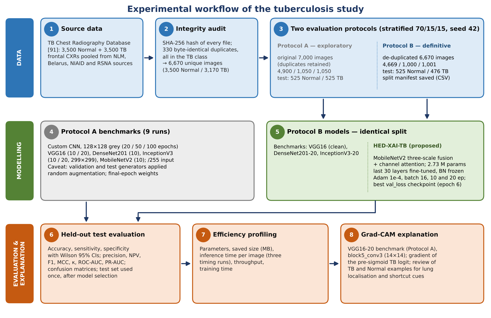
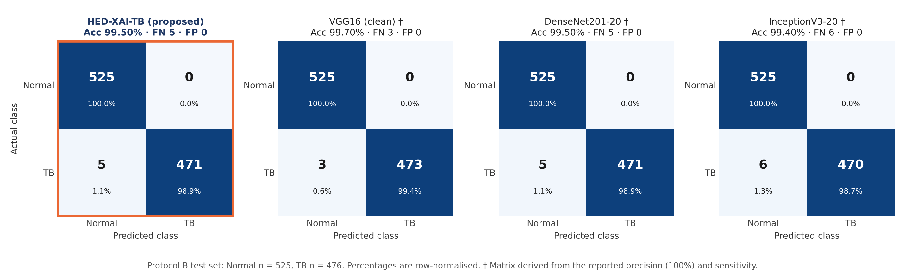
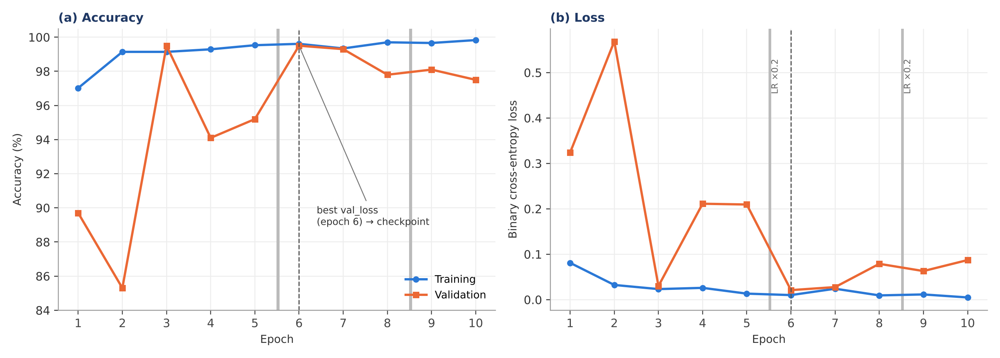
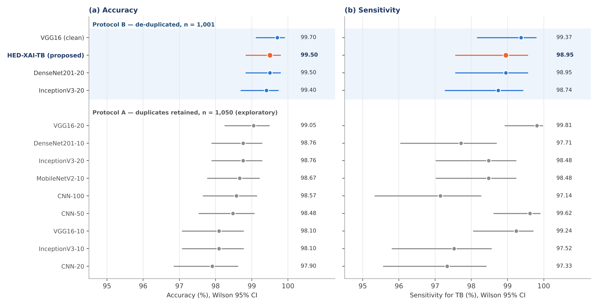
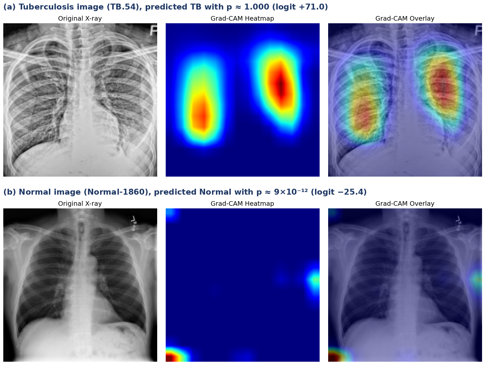

# HED-XAI-TB — Tuberculosis Detection from Chest X-rays (Normal vs. Tuberculosis)

Code, executed notebooks and complete training/evaluation records for the **tuberculosis** part of the PhD
dissertation (Chapter IV §4.2.1; Chapter V §5.1 and §5.6).

**Task:** binary classification of frontal chest radiographs from the TB Chest Radiography Database
(Rahman et al., IEEE Access 2020; 3,500 Normal + 3,500 Tuberculosis). Positive class = Tuberculosis.



## Two evaluation protocols

| | Protocol A — exploratory | Protocol B — definitive |
|---|---|---|
| Images | original 7,000 (330 byte-identical duplicates retained) | 6,670 after SHA-256 de-duplication (3,500 Normal / 3,170 TB) |
| Split (stratified, seed 42) | 4,900 / 1,050 / 1,050 | 4,669 / 1,000 / 1,001 (split manifest saved) |
| Test set | 525 Normal / 525 TB | 525 Normal / 476 TB |
| Models | 9 benchmark runs (notebooks 01–07) | HED-XAI-TB (notebook 08) + VGG16, DenseNet201-20, InceptionV3-20 |
| Use | transparency only — **not** used for ranking | all comparisons in the dissertation |

Protocol A has three known problems: duplicates can sit in both training and test partitions (≈69 TB test images
expected to have an identical training copy), the transfer-learning notebooks applied random augmentation to the
validation/test generators (so `model.evaluate` and `model.predict` disagree by up to 0.96 points), and all runs
used final-epoch weights.

## Proposed model: HED-XAI-TB

| Component | Configuration |
|---|---|
| Backbone | MobileNetV2 (ImageNet), 224×224, MobileNetV2 `preprocess_input`; last 30 layers fine-tuned, BatchNorm frozen |
| Multi-scale taps | `block_3_expand_relu` (56×56×144), `block_6_expand_relu` (28×28×192), `out_relu` (7×7×1280) → GAP each |
| Fusion | Concatenate (1,616-d) → BatchNorm → Dense 256 (ReLU) → Dropout 0.35 |
| Attention | Channel attention: Dense 32 (ReLU) → Dense 256 (sigmoid) ⊙ features |
| Head | Dense 128 (ReLU) → Dropout 0.25 → Dense 1 (sigmoid) |
| Training | Adam 1e-4, batch 16, 10 epochs (20-epoch confirmation run), ModelCheckpoint (val_loss), ReduceLROnPlateau (×0.2, patience 2), seed 42; augmentation rotation ±8°, shifts 4 %, zoom 8 %, horizontal flip (training only) |
| Size | 2,728,097 parameters (1,977,601 trainable), 25.89 MB, 10.86 ms/image (10.86–20.65 ms over three timing runs), 18.31 min training (CPU) |

Best checkpoint: epoch 6 (val_loss 0.0210). The 20-epoch run reproduced epochs 1–5 exactly and selected the same
checkpoint, so its test results are identical (deterministic pipeline, not an independent replication).

## Results

| Protocol | Model | Test n | Accuracy % [95% CI] | Sensitivity % | Specificity % | MCC | FN / FP | Params (M) |
|---|---|---|---|---|---|---|---|---|
| B | VGG16 (clean) | 1,001 | 99.70 [99.12–99.90] | 99.37 | 100.00 | 0.994 | 3 / 0 | 14.88 |
| B | **HED-XAI-TB (proposed)** | 1,001 | **99.50** [98.84–99.79] | 98.95 | 100.00 | 0.990 | 5 / 0 | 2.73 |
| B | DenseNet201-20 | 1,001 | 99.50 [98.84–99.79] | 98.95 | 100.00 | 0.990 | 5 / 0 | 18.83 |
| B | InceptionV3-20 | 1,001 | 99.40 [98.70–99.73] | 98.74 | 100.00 | 0.988 | 6 / 0 | 22.34 |
| A | VGG16-20 | 1,050 | 99.05 [98.26–99.48] | 99.81 | 98.29 | 0.981 | 1 / 9 | 27.69 |
| A | DenseNet201-10 | 1,050 | 98.76 [97.89–99.28] | 97.71 | 99.81 | 0.975 | 12 / 1 | 19.44 |
| A | InceptionV3-20 | 1,050 | 98.76 [97.89–99.28] | 98.48 | 99.05 | 0.975 | 8 / 5 | 22.98 |
| A | MobileNetV2-10 | 1,050 | 98.67 [97.77–99.20] | 98.48 | 98.86 | 0.973 | 8 / 6 | 3.05 |
| A | CNN-100 | 1,050 | 98.57 [97.66–99.13] | 97.14 | 100.00 | 0.972 | 15 / 0 | 14.82 |
| A | CNN-50 | 1,050 | 98.48 [97.54–99.06] | 99.62 | 97.33 | 0.970 | 2 / 14 | 14.82 |
| A | VGG16-10 | 1,050 | 98.10 [97.08–98.76] | 99.24 | 96.95 | 0.962 | 4 / 16 | 27.69 |
| A | InceptionV3-10 | 1,050 | 98.10 [97.08–98.76] | 97.52 | 98.67 | 0.962 | 13 / 7 | 22.98 |
| A | CNN-20 | 1,050 | 97.90 [96.85–98.61] | 97.33 | 98.48 | 0.958 | 14 / 8 | 14.82 |

*All metrics recomputed from the confusion matrices (95% CI = Wilson interval). Protocol B: all four models have
100 % specificity and differ only by 3–6 missed TB cases; no difference is statistically significant (p ≥ 0.48).
HED-XAI-TB: ROC-AUC = PR-AUC = 0.999996, NPV 99.06 %. Protocol B benchmark matrices are derived from their recorded
precision (100 %) and sensitivity. Full table: [`results/metrics_summary.csv`](results/metrics_summary.csv).*

<p align="center">
  <br>
  <br>
  <br>
  
</p>

## Folder structure

```
tuberculosis/
├── notebooks/            # 9 executed notebooks (outputs preserved)
│   ├── 01–07_protocolA_*         # exploratory benchmarks (CNN, VGG16, DenseNet201, InceptionV3, MobileNetV2)
│   ├── 08_protocolB_HED-XAI-TB_hybrid_10_and_20_epochs.ipynb
│   └── 09_GradCAM_VGG16_explanations.ipynb
├── src/
│   ├── hybrid/train_hed_xai_tb.py       # de-duplication, split, training and full evaluation (proposed model)
│   ├── hybrid/evaluate_hed_xai_tb.py    # re-evaluation of the saved checkpoint + figures
│   ├── baselines/                       # 9 Protocol A benchmark scripts
│   ├── explainability/gradcam_vgg16.py  # Grad-CAM (pre-sigmoid logit, block5_conv3)
│   ├── demo/tb_api_fastapi.py           # research demo API (not a medical device)
│   └── analysis/                        # statistics and dissertation figures
├── results/
│   ├── metrics_summary.csv              # both protocols: CIs, sensitivity, specificity, NPV, MCC, κ, confusion counts
│   ├── metrics_all_models.json
│   ├── training_logs/                   # per-epoch training/validation metrics (CSV)
│   ├── classification_reports/          # test results as printed by each run
│   └── figures/                         # notebook figures, Grad-CAM, dissertation figures
└── data/README.md
```

## How to reproduce

```bash
pip install -r ../requirements.txt
# 1) download the database (see data/README.md) to data/TB_Chest_Radiography_Database/{Normal,Tuberculosis}
# 2) proposed model (Protocol B: de-duplication + split + training + evaluation)
python src/hybrid/train_hed_xai_tb.py          # outputs -> outputs/HED-XAI-TB/
# 3) exploratory benchmarks, e.g.
python src/baselines/vgg16_20_epochs.py         # outputs -> outputs/vgg16_20/
# 4) Grad-CAM (needs the VGG16-20 model from step 3)
python src/explainability/gradcam_vgg16.py
# 5) statistics and figures (no GPU needed)
python src/analysis/statistics.py && python src/analysis/make_result_charts.py
```

## Notes on the records

- `src/` contains the code of the executed notebook cells; only hard-coded paths were replaced by environment
  variables (`TB_DATA_DIR`, `TB_OUTPUT_DIR`, `TB_VGG16_MODEL`), and `plt.show()` saves figures to disk. A URL that
  had been pasted by accident into the plotting code of the CNN-100 cell was removed.
- The notebooks of the three Protocol B benchmarks (VGG16, DenseNet201-20, InceptionV3-20) are not part of this
  folder; their metrics and efficiency figures are taken from the experiment records cited in the dissertation.
- A second, uncleaned copy of the Grad-CAM notebook (same code, absolute Windows paths) was omitted.
- **Limitations:** the database pools images from different sources, and Normal and TB images come largely from
  different collections, so acquisition differences could act as a shortcut; no patient identifiers are available,
  so only byte-identical duplicates could be removed; all evaluation is internal. Grad-CAM maps come from the
  Protocol A VGG16-20 benchmark, not from HED-XAI-TB; for the Normal example the residual tuberculosis evidence lies
  on the image border — see the dissertation, §5.1.6 and §5.6.
- Trained weights are not stored in Git; attach them to a GitHub Release if you want to share them.
